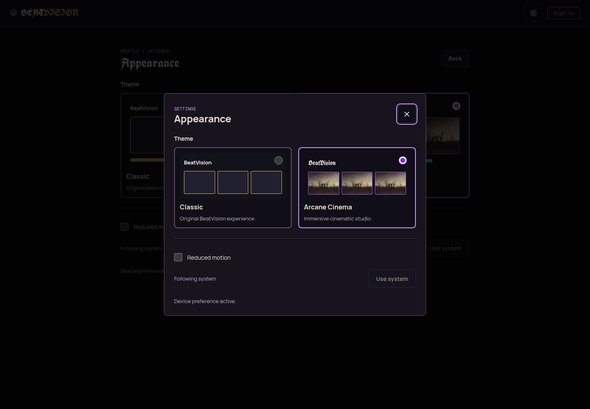
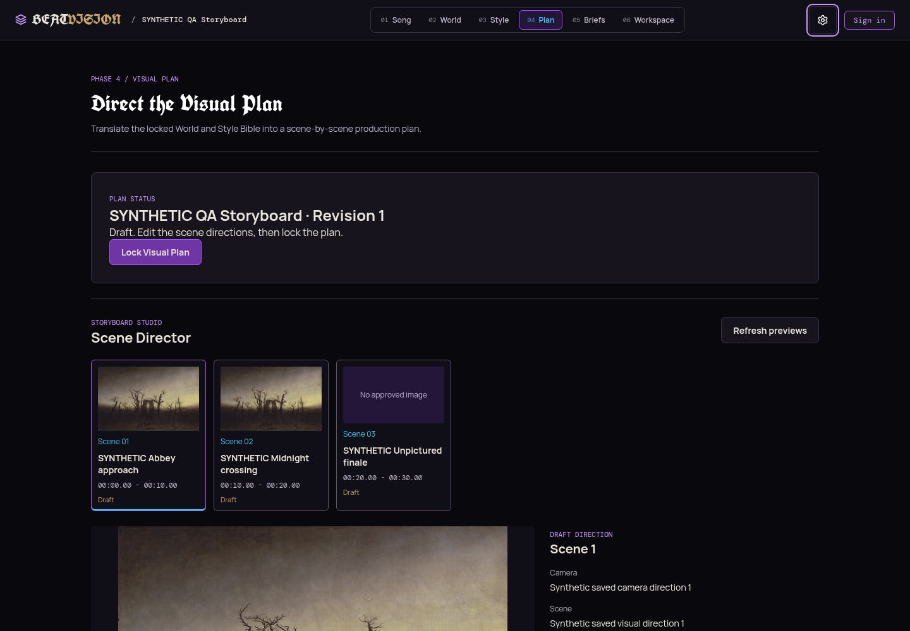

# Dual-theme implementation evidence

## Scope and baseline

- Repository: `DaddyDom8249/BeatVision`.
- Starting checkout and freshly fetched `origin/main`: `f2e137584d18ed222ca702b89cd8430c3b06b506`.
- Dedicated branch: `feature/arcane-cinema-theme`.
- Reconciliation parent: existing remote theme work `94f3c245011e0d53a7f3199f20ff7e71bb977f30`, discovered at final publish check. Its commit history and original log are preserved; this continues the existing draft pull request rather than opening a duplicate or force-pushing.
- Read the complete `AGENTS.md` and `PROJECT_LOG.md`, styling/routes/header/pages, auth client, production image-playback contract, relevant tests/audits and related open work before editing.
- Classic is the verified main interface, not the unmerged ink-studio proposal. Existing Style/Mood intake work and local-analysis repairs remain separate, unmerged pull requests.
- No main merge, deployment, production mutation, generation, new API, dependency or database migration is part of this feature. Automatic Vercel deployment for this feature branch is explicitly disabled in `vercel.json`.

## Implemented

- A synchronous pre-React bootstrap validates cached preferences and applies root theme/motion attributes. The same resolver is used by the centralized TypeScript store; corrupt/blocked storage does not stop the app.
- `classic` is the default; `arcane` is opt-in. Explicit valid authenticated preference fields override local fields, which override Classic/system defaults.
- Account preference uses Supabase Auth's existing `updateUser({ data: ... })` contract under `beatvision_appearance`. This metadata is display-only, never an authorization source. No profile table or RLS migration is needed. Other user metadata is not replaced.
- Local fallback key: `beatvision.appearance.v1`. Account write failures retain the immediate local choice and show a retry state. Requests are serialized/coalesced, stale responses are ignored, and sign-out/account changes cancel queued old-owner writes.
- Existing initial-branch `{ theme, reducedMotion }` preferences remain compatible: true maps to reduce, false to system, and explicit new motion values take precedence. Existing ThemeProvider, arcane stylesheet and navigation AppearanceSettings entry paths are reused. The old five-case fixture is replaced by expanded real store/provider/UI tests covering those acceptance behaviors and migration.
- Header Appearance gear opens an in-place native dialog; existing editors stay mounted. Direct Settings and Appearance routes share the same controls. Theme preview cards provide immediate selection and one-action reversion.
- Reduced motion follows the OS unless explicitly overridden. System changes are observed live; the setting suppresses CSS animation/transitions and smooth storyboard scrolling.
- Arcane overrides reusable existing tokens across all workflow pages, uses restrained obsidian/purple surfaces with violet/cyan/gold accents, and applies local OFL blackletter to branding/major headings while retaining readable control typography.
- Arcane storyboard is a read-only scene navigator with actual scene numbers/timestamps/status, approved saved-image previews, focused preview and camera/scene/location summary. It scrolls/focuses the original scene editor. Existing editing, locking, revisions, generation, approval and production controls remain intact.
- Preview queries are scoped to project/plan and approved asset state. Private images use the existing owner-checked `image_url` action, never generation/enqueue. Refreshes clear stale imagery, failed images are marked unavailable rather than unapproved, and one failed URL does not hide other valid images.
- Artwork is Friedrich's public-domain *The Abbey in the Oakwood*, explicitly decorative, not generated project output. Font/artwork/Lucide icon licenses are included beside their assets.

## Classic compatibility

`src/styles.css` is unchanged byte for byte. Its verified SHA-256 is:

`cd0bd4cf0f25fbe5f29f6e8bc1aab59d6701486902d40845911da13f07835b02`

Arcane page overrides are root-theme scoped. The intentional Classic additions are the header Appearance gear and the new settings surfaces. Reduced-motion changes honor the requested user/OS accessibility preference. The Classic storyboard performs no additional reads and renders no new overview. Scene editor identifiers/focus targets are additive only.

## Verification commands

Baseline before edits:

| Command | Result | Exit |
| --- | --- | --- |
| `npm test` | 261 passed, 0 failed | 0 |
| `./node_modules/.bin/tsc -b` | Passed | 0 |
| `npm run build` | Passed | 0 |
| `npm run production-audit` | Passed | 0 |

Implemented candidate:

| Command | Result | Exit |
| --- | --- | --- |
| `npm test` | 289 passed, 0 failed | 0 |
| `node --test scripts/test/integration-repair-20261011/*.test.mjs` | 6 passed, 0 failed | 0 |
| `node --test scripts/test/appearance.test.mjs scripts/test/appearance-ui.test.mjs` | Covered by full suite; theme/store/UI regression tests pass | 0 |
| `./node_modules/.bin/tsc -b` | Passed | 0 |
| `npm run build -- --outDir /tmp/beatvision-arcane-build` | Passed; separate output preserves baseline browser server | 0 |
| `npm run build` | Passed after baseline comparisons finished | 0 |
| `npm run production-audit` | Passed | 0 |
| `git diff --check` | Passed | 0 |

No lint script/config is provided by the repository. No lint result is claimed. Vite's existing large-chunk warning remains: candidate JavaScript about 922 kB before gzip versus about 908 kB baseline. No performance improvement is claimed. Font/artwork are local static assets; no animation loop or graphics engine was added.

Automated regressions exercise actual store/provider/controls in jsdom, startup ordering, default selection, preference precedence, reload/sign-in persistence through synthetic auth, storage denial, write failure/retry, mismatched server acknowledgement, rapid selection/account races, provider restart, OS/custom motion, unsaved-editor identity, modal keyboard wrapping/focus return, settings routing, Classic CSS checksum, token contrast, read-only storyboard requests, authoritative fractional times, approved-only previews, and unavailable/error states.

## Browser evidence

Real Chromium 154/Playwright is available locally. Baseline home/auth screenshots were captured at 1440x1000, 360x800 and 320x800 with the existing fonts loaded. Implemented home/auth/settings/dialog captures additionally cover 768x1024. Initial checks established immediate theme switching, reload persistence without a Classic flash, keyboard radio selection, Escape focus return and live/explicit reduced-motion behavior.

Local evidence root: `/tmp/beatvision-arcane-qa`. Baseline notes: `BASELINE.md`; final browser report: `QA-REPORT.md`; summarized checks: `implemented/QA-SUMMARY.json`; full annotated run history: `implemented/implementation-results.json`. Authenticated-looking song/storyboard screenshots use explicitly synthetic, intercepted API fixtures, not production users or generation.

Verified in real Chromium at 1440x1000, 768x1024, 360x800 and 320x800: radio/keyboard selection, modal Tab wrapping, Escape/focus return, immediate same-document switching, local reload persistence and no observed intermediate Classic root attribute, OS/explicit motion and Use system, actual font/artwork decode, and contained document width. Synthetic fixtures verify unsaved Song title/artist/lyrics/direction/notes/audio-file preservation, scene editor identity/draft preservation, approved-only storyboard imagery, actual times/status, empty/failure/broken/partial-refresh states, stale-image clearing/recovery, locked review and reduced-motion editor focus. No generation or real API mutation was sent.

Classic desktop content below the intentional header addition matched baseline pixels exactly. Narrow-screen header height increases by 5px at 360px and 7px at 320px due to the new control; after alignment, home matches exactly or within one pixel and auth differences are at most two channel levels. This is not a claim of total header pixel equivalence or exhaustive production visual coverage.

**RESOLVED:** Independent QA found a 9px Arcane brand/settings overlap at 320px. The Arcane-only mobile brand container retains intrinsic width and the action row can use available width, so controls wrap without overlap and Sign in remains one line. A CSS regression protects the rules. Real-browser rechecks passed at 320px/360px, including a long synthetic account email; edit/review focus remains below the wrapped sticky header. No current browser finding remains in the tested public/synthetic scope. Earlier strict native-dialog BODY checks and exact implicit-label fixture lookups in the raw history are annotated as superseded harness results, not unresolved product failures.

Selected real local screenshots (synthetic project media are labeled in their filenames and on screen):

- `implemented/LATEST-arcane-dialog-short-preview-1440x1000.png`
- `implemented/LATEST-classic-dialog-short-preview-1440x1000.png`
- `implemented/MOCKED-arcane-song-unsaved-320x800-full.png`
- `implemented/MOCKED-storyboard-approved-1440x1000-arcane-full.png`
- `implemented/MOCKED-storyboard-approved-320x800-arcane-full.png`
- `implemented/RESOLVED-arcane-signed-out-home-320x800.png`
- `implemented/FINAL-MOCKED-storyboard-approved-focus-320x800.png`
- `implemented/FINAL-MOCKED-storyboard-locked-focus-320x800.png`

Repository review captures:

## Changed files

| Files | Purpose |
| --- | --- |
| `public/appearance-init.js`, `index.html` | Shared validated startup preference before React/CSS |
| `src/theme/appearance.ts`, `ThemeProvider.tsx`, `arcane.css` | Single preference engine, React context, scoped design tokens and motion |
| `src/components/appearance/*`, `navigation/AppearanceSettings.tsx`, `navigation/StudioHeader.tsx` | Live cards, reduced motion, account/device status, accessible in-place dialog and existing header entry |
| `src/pages/AppearancePage.tsx`, `src/app/App.tsx`, `routes.tsx`, `src/main.tsx` | Appearance route and application-wide provider |
| `src/components/storyboard/ArcaneStoryboard.tsx`, `src/pages/VisualPlanPage.tsx` | Read-only navigator and focus links to unchanged existing editors |
| `public/art/*`, `public/fonts/*`, `public/icons/*` | Local licensed art/font/icons and license records |
| `scripts/test/appearance*.test.mjs`, `auth-navigation.test.mjs`, `studio-redesign.test.mjs` | Expanded regressions, route coverage and updated isolated-component fixtures |
| `vercel.json` | Disable automatic deployment of this feature branch |
| `PROJECT_LOG.md`, this document, `docs/appearance/*` | Preserved history, evidence, limitations and actual review captures |

## Known limitations and separate work

- **NOT VERIFIED:** Real authenticated account preference writes and cross-device sign-in persistence. These are implemented and tested with synthetic auth; no production credential was used or account changed.
- **NOT VERIFIED:** Authenticated production pipeline/provider playback, motion generation, final assembly and MP4 completion. Theme tests do not establish those workflows. Existing media/generation code is unchanged.
- **CONFIRMED, pre-existing:** Signed-out dashboard shows `Auth session missing!` and unavailable projects in the unchanged baseline.
- **CONFIRMED, separate repair:** Supplied local audio-analysis section-validation failure is addressed in the independent unmerged song-analysis repair, not silently bundled here.
- **NOT VERIFIED:** Physical Android device, screen reader and low-memory hardware performance. Desktop Chromium mobile viewports are not physical-device testing.
- **NOT VERIFIED:** Exhaustive visual equivalence of every authenticated production/third-party overlay state. Shared tokens support existing controls; captured synthetic and public states must not be described as a complete live pipeline pass.
- **NOT DEPLOYED:** This candidate has no hosted preview or production deployment. The existing draft pull request lists a prior preview for older source; it must not be represented as this candidate. Local dev server is available for review. No merge or deployment is authorized by this task.
